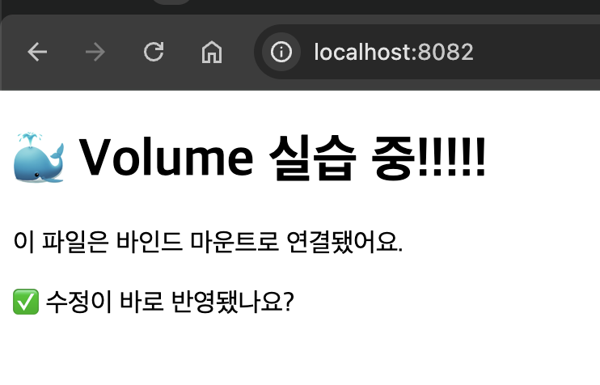
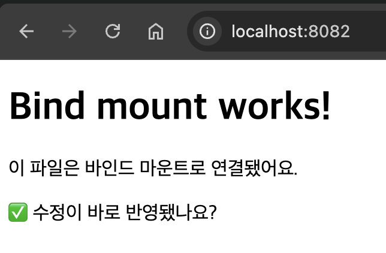

# 내 컴퓨터에 개발자용 '작업실' 꾸미기

터미널, Docker, Git/GitHub로 **재현 가능한 개발 환경**을 만들고, 모든 과정을 명령어와 출력 로그, 캡처로 남긴 기술 문서입니다.

**저장소**: https://github.com/zxcvxzxcv/codyssey_p

## 목차
1. [프로젝트 개요](#1-프로젝트-개요)
2. [실행 환경](#2-실행-환경)
3. [수행 체크리스트](#3-수행-체크리스트)
4. [검증 방법 요약](#4-검증-방법-요약)
5. [수행 로그](#5-수행-로그)
6. [개념 정리](#6-개념-정리)
7. [트러블슈팅](#7-트러블슈팅)
8. [보안 및 개인정보](#8-보안-및-개인정보)
9. [재현 방법](#9-재현-방법)

---

## 1. 프로젝트 개요

**미션 목표**
- 리눅스 CLI로 작업 디렉토리와 파일 권한을 다룬다.
- Docker를 설치·점검하고 컨테이너를 실행·관리한다.
- Dockerfile로 커스텀 이미지를 만들고, 포트 매핑·바인드 마운트·볼륨으로 접속, 변경 반영, 데이터 영속성을 검증한다.
- Git/GitHub를 설정하고 저장소를 연동한다.

**Docker 환경 참고**: macOS에서 Docker 엔진으로 **OrbStack**을 사용했습니다. OrbStack을 실행하면 Docker 엔진이 함께 구동되며, 터미널에서는 일반 `docker` 명령을 그대로 사용합니다. (`docker info`의 Context가 `orbstack`)

---

## 2. 실행 환경

| 항목 | 값 |
|---|---|
| OS | macOS (Apple Silicon, aarch64) |
| Shell / Terminal | zsh / VSCode 통합 터미널 |
| Docker | 29.8.2 (build 7fc2dff), Context: `orbstack` |
| Docker Compose / Buildx | v5.5.0 / v0.37.2 |
| Git | 2.54.0 (Apple Git-157) |
| 에디터 | VSCode |

```bash
$ docker --version
Docker version 29.8.2, build 7fc2dff

$ git --version
git version 2.54.0 (Apple Git-157)
```

---

## 3. 수행 체크리스트

- [x] 터미널 기본 조작 (위치/목록/이동/생성/복사/이동·이름변경/삭제/내용 확인)
- [x] 권한 변경 실습 (파일 1개 + 디렉토리 1개)
- [x] Docker 설치/점검 (`docker --version`, `docker info`)
- [x] 이미지/컨테이너 기본 운영 (`images`, `ps`, `ps -a`, `logs`, `stats`, `stop`, `rm`)
- [x] `hello-world` 실행
- [x] `ubuntu` 컨테이너 실행 및 내부 명령 수행
- [x] 컨테이너 종료/유지 (`run -it` / `exec` / `attach`) 관찰
- [x] Dockerfile 작성 및 커스텀 이미지 빌드/실행 (`my-web:1.0`)
- [x] 포트 매핑 접속 (8080:80, 8081:80)
- [x] 바인드 마운트 변경 반영
- [x] Docker 볼륨 영속성 (named volume)
- [x] Git 사용자 정보/기본 브랜치 설정
- [x] GitHub 저장소 연동 및 push
- [ ] VSCode GitHub 로그인 연동 캡처 (5-10 참고)

---

## 4. 검증 방법 요약

| 항목 | 사용한 명령 | 확인한 것 | 결과 위치 |
|---|---|---|---|
| 터미널 조작 | `pwd`, `ls -la`, `cp`, `mv`, `rm` 등 | 생성/복사/이동/삭제 동작 | [5-1](#5-1-터미널-기본-조작) |
| 권한 | `chmod`, `ls -l` | 변경 전/후 권한 비교 | [5-2](#5-2-권한-실습) |
| Docker 설치/데몬 | `docker --version`, `docker info` | 버전, Server 정보 출력 | [5-3](#5-3-docker-설치-및-점검) |
| 운영 명령 | `docker images / ps / logs / stats / stop / rm` | 이미지, 상태, 로그, 리소스 | [5-4](#5-4-이미지컨테이너-기본-운영) |
| 컨테이너 실행 | `docker run hello-world`, `docker run -it ubuntu bash` | 실행 성공, 내부 진입 | [5-5](#5-5-컨테이너-실행-실습) |
| 이미지 빌드 | `docker build -t my-web:1.0 .` | 빌드 성공 | [5-6](#5-6-dockerfile-기반-커스텀-이미지) |
| 포트 매핑 | `docker run -p 8080:80`, `-p 8081:80` | 호스트 포트로 응답 수신 | [5-7](#5-7-포트-매핑) |
| 바인드 마운트 | `-v "$(pwd)/site":/usr/share/nginx/html` | 호스트 수정이 즉시 반영 | [5-8](#5-8-바인드-마운트) |
| 볼륨 영속성 | `docker volume create`, 컨테이너 삭제 후 재연결 | 데이터 유지 | [5-9](#5-9-docker-볼륨-영속성) |
| Git/GitHub | `git config --list`, `git push` | 사용자 설정, 원격 업로드 | [5-10](#5-10-git-설정-및-github-연동) |

---

## 5. 수행 로그

### 5-1. 터미널 기본 조작

```bash
$ mkdir -p ~/codyssey/practice && cd ~/codyssey/practice
$ pwd
/Users/<user>/codyssey/practice
$ ls -la
total 0
drwxr-xr-x@ 2 <user>  staff   64 Nov  2 21:24 .
drwxr-xr-x  5 <user>  staff  160 Nov  2 21:24 ..
$ touch a.txt
$ echo "hello" > b.txt
$ cat b.txt
hello
$ cp b.txt c.txt
$ mv c.txt d.txt                 # 이름 변경
$ mkdir sub && mv d.txt sub/     # 이동
$ ls -la . sub
.:
total 8
drwxr-xr-x@ 5 <user>  staff  160 Nov  2 21:25 .
drwxr-xr-x  5 <user>  staff  160 Nov  2 21:24 ..
-rw-r--r--@ 1 <user>  staff    0 Nov  2 21:25 a.txt
-rw-r--r--@ 1 <user>  staff    6 Nov  2 21:25 b.txt
drwxr-xr-x@ 3 <user>  staff   96 Nov  2 21:25 sub

sub:
total 8
drwxr-xr-x@ 3 <user>  staff   96 Nov  2 21:25 .
drwxr-xr-x@ 5 <user>  staff  160 Nov  2 21:25 ..
-rw-r--r--@ 1 <user>  staff    6 Nov  2 21:25 d.txt
$ rm a.txt
$ rm -r sub
$ ls -la
total 8
drwxr-xr-x@ 3 <user>  staff   96 Nov  2 21:25 .
drwxr-xr-x  5 <user>  staff  160 Nov  2 21:24 ..
-rw-r--r--@ 1 <user>  staff    6 Nov  2 21:25 b.txt
```

> `@`는 macOS의 확장 속성 표시이며 권한 해석에는 영향이 없다. 연습은 Git 저장소 밖(`~/codyssey/practice`)에서 수행했다.

### 5-2. 권한 실습

**파일**
```bash
$ touch perm.txt
$ ls -l perm.txt          # 변경 전
-rw-r--r--@ 1 <user>  staff  0 Nov  2 21:26 perm.txt
$ chmod 600 perm.txt
$ ls -l perm.txt          # 변경 후
-rw-------@ 1 <user>  staff  0 Nov  2 21:26 perm.txt
```

**디렉토리**
```bash
$ mkdir permdir
$ ls -ld permdir          # 변경 전
drwxr-xr-x@ 2 <user>  staff  64 Nov  2 21:26 permdir
$ chmod 644 permdir
$ ls -ld permdir          # x 권한 제거 후
drw-r--r--@ 2 <user>  staff  64 Nov  2 21:26 permdir
$ cd permdir
cd: permission denied: permdir
$ chmod 755 permdir
$ ls -ld permdir          # 복구 후
drwxr-xr-x@ 2 <user>  staff  64 Nov  2 21:26 permdir
$ cd permdir && cd ..
```

**관찰**
- 파일: `644`(rw-r--r--)에서 `600`(rw-------)으로 바꾸자 그룹/기타 사용자의 읽기 권한이 사라졌다.
- 디렉토리: `x`(실행) 권한을 빼자 `cd`가 `permission denied`로 막혔고, `755`로 복구하자 다시 들어갈 수 있었다. 디렉토리에서 `x`는 "안으로 들어갈 수 있는 권한"이다.

### 5-3. Docker 설치 및 점검

```bash
$ docker --version
Docker version 29.8.2, build 7fc2dff
```

```bash
$ docker info        # 발췌
Client:
 Version:    29.8.2
 Context:    orbstack
 Plugins:
  buildx: Docker Buildx (Docker Inc.)   Version: v0.37.2
  compose: Docker Compose (Docker Inc.) Version: v5.5.0

Server:
 Containers: 1
 Server Version: 29.8.2
 Storage Driver: overlayfs
 Logging Driver: json-file
 Cgroup Version: 2
 Default Runtime: runc
 Kernel Version: 7.2.12-orbstack-00394-gbecdd6130068
 Operating System: OrbStack
 OSType: linux
 Architecture: aarch64
 CPUs: 10
 Total Memory: 7.816GiB
 ...
WARNING: DOCKER_INSECURE_NO_IPTABLES_RAW is set
```

`Server:` 항목이 정상 출력되므로 Docker 데몬이 동작 중이다. `DOCKER_INSECURE_NO_IPTABLES_RAW` 경고는 OrbStack 환경에서 나타나며 동작에는 영향이 없었다.

### 5-4. 이미지/컨테이너 기본 운영

```bash
$ docker images
IMAGE                ID             DISK USAGE   CONTENT SIZE   EXTRA
hello-world:latest   c567b231f656       18.5kB         10.3kB    U
my-web:1.0           de98bc82200c        258MB         62.2MB
ubuntu:latest        6a06111c3b0a        179MB         44.9MB    U
```

```bash
$ docker ps
CONTAINER ID   IMAGE        COMMAND                  CREATED        STATUS        PORTS                                     NAMES
e236b281a852   my-web:1.0   "/docker-entrypoint.…"   14 hours ago   Up 14 hours   0.0.0.0:8082->80/tcp, [::]:8082->80/tcp   web-bind
260c31955d13   ubuntu       "sleep infinity"         14 hours ago   Up 14 hours                                             vol-test2
0e6004bfa3a8   my-web:1.0   "/docker-entrypoint.…"   14 hours ago   Up 14 hours   0.0.0.0:8081->80/tcp, [::]:8081->80/tcp   web-8081
ea59825f4b8b   my-web:1.0   "/docker-entrypoint.…"   14 hours ago   Up 14 hours   0.0.0.0:8080->80/tcp, [::]:8080->80/tcp   web-8080
```

```bash
$ docker logs web-8080        # 발췌
/docker-entrypoint.sh: Configuration complete; ready for start up
2026/11/02 12:30:13 [notice] 1#1: nginx/1.31.8
2026/11/02 12:30:13 [notice] 1#1: OS: Linux 7.2.12-orbstack-00394-gbecdd6130068
2026/11/02 12:30:13 [notice] 1#1: start worker processes
...
192.168.215.1 - - [02/Nov/2026:12:30:13 +0000] "GET / HTTP/1.1" 200 220 "-" "curl/8.7.1" "-"
192.168.215.1 - - [02/Nov/2026:12:34:10 +0000] "GET / HTTP/1.1" 200 220 "-" "curl/8.7.1" "-"
192.168.215.1 - - [02/Nov/2026:23:28:08 +0000] "GET / HTTP/1.1" 200 220 "-" "Mozilla/5.0 (Macintosh; ...) Chrome/156.0.0.0 Safari/537.36" "-"
```
- nginx 시작 메시지와 함께 `GET / HTTP/1.1 200` 요청 기록(curl, 브라우저)이 남아 있어, 접속이 성공했음을 확인할 수 있다.

```bash
$ docker stats --no-stream
CONTAINER ID   NAME        CPU %     MEM USAGE / LIMIT     MEM %     NET I/O           BLOCK I/O     PIDS
e236b281a852   web-bind    0.00%     8.68MiB / 7.816GiB    0.11%     5.87kB / 3.62kB   25.3MB / 0B   11
260c31955d13   vol-test2   0.00%     2.242MiB / 7.816GiB   0.03%     1.29kB / 126B     4.95MB / 0B   1
0e6004bfa3a8   web-8081    0.00%     8.512MiB / 7.816GiB   0.11%     5.28kB / 3.81kB   1.72MB / 0B   11
ea59825f4b8b   web-8080    0.00%     8.652MiB / 7.816GiB   0.11%     5.05kB / 3.37kB   32.1MB / 0B   11
```
- nginx 컨테이너가 약 8.5MiB 메모리만 사용해 컨테이너가 가볍다는 점을 볼 수 있다.

**중지/삭제**
```bash
$ docker stop web-test
web-test
$ docker rm web-test
web-test
$ docker ps          # 해당 컨테이너가 목록에서 사라짐
```

### 5-5. 컨테이너 실행 실습

**hello-world**
```bash
$ docker run hello-world

Hello from Docker!
This message shows that your installation appears to be working correctly.

To generate this message, Docker took the following steps:
 1. The Docker client contacted the Docker daemon.
 2. The Docker daemon pulled the "hello-world" image from the Docker Hub.
    (arm64v8)
 3. The Docker daemon created a new container from that image which runs the
    executable that produces the output you are currently reading.
 4. The Docker daemon streamed that output to the Docker client, which sent it
    to your terminal.
...
$ docker ps -a
CONTAINER ID   IMAGE         COMMAND    CREATED                  STATUS                              PORTS     NAMES
4edbda0abe3d   hello-world   "/hello"   Less than a second ago   Exited (0) Less than a second ago             unruffled_nash
534f2eec44fa   ubuntu        "bash"     35 minutes ago           Exited (0) 34 minutes ago                     ubuntu-test
9b5951d6992d   hello-world   "/hello"   35 minutes ago           Exited (0) 35 minutes ago                     goofy_varahamihira
```

**ubuntu 컨테이너 진입**
```bash
$ docker run -it --name ubuntu-test ubuntu bash
Unable to find image 'ubuntu:latest' locally
latest: Pulling from library/ubuntu
6f01cc7d6fb3: Pull complete
afa7f7d582de: Pull complete
d597c14cfeb9: Download complete
Digest: sha256:6a06111c3b0a8600feadb270aec771dc239bf407b25625f93f44ab00e11f4d3c
Status: Downloaded newer image for ubuntu:latest
root@534f2eec44fa:/# ls
bin  boot  dev  etc  home  lib  media  mnt  opt  proc  root  run  sbin  srv  sys  tmp  usr  var
root@534f2eec44fa:/# echo "hello from container"
hello from container
root@534f2eec44fa:/# cat /etc/os-release
PRETTY_NAME="Ubuntu 26.04.1 LTS"
NAME="Ubuntu"
VERSION_ID="26.04"
...
root@534f2eec44fa:/# exit
```
> 호스트는 macOS인데 컨테이너 내부는 Ubuntu 리눅스다. 컨테이너가 호스트와 분리된 격리 환경에서 동작함을 확인했다.

**종료/유지 비교 (run -it / exec / attach)**
```bash
# 실험 A: run -it 후 exit
$ docker run -it --name exp-a ubuntu bash
root@6b58a9ac6428:/# exit

# 실험 B: exec 로 들어갔다 나오기
$ docker run -d --name exp-b ubuntu sleep infinity
$ docker exec -it exp-b bash
root@70b96af700d2:/# exit
$ docker ps
CONTAINER ID   IMAGE     COMMAND            CREATED          STATUS          PORTS     NAMES
70b96af700d2   ubuntu    "sleep infinity"   18 seconds ago   Up 17 seconds             exp-b

# 실험 C: attach 후 exit
$ docker run -dit --name exp-c ubuntu bash
$ docker attach exp-c
root@7f00c37ad9eb:/# exit
$ docker ps -a
CONTAINER ID   IMAGE         COMMAND            CREATED          STATUS                          PORTS     NAMES
7f00c37ad9eb   ubuntu        "bash"             11 seconds ago   Exited (0) 5 seconds ago                  exp-c
70b96af700d2   ubuntu        "sleep infinity"   46 seconds ago   Up 45 seconds                             exp-b
6b58a9ac6428   ubuntu        "bash"             2 minutes ago    Exited (0) About a minute ago             exp-a
...
```

| 방식 | 붙는 대상 | exit 후 컨테이너 | 근거 |
|---|---|---|---|
| `run -it` | 메인 프로세스(bash) | **종료** | `exp-a`, `ubuntu-test` → Exited (0) |
| `exec -it` | 새로 만든 별도 프로세스 | **유지** | `exp-b` → Up |
| `attach` | 메인 프로세스(bash) | **종료** | `exp-c` → Exited (0) |

**정리**: 컨테이너는 메인 프로세스가 살아 있는 동안만 실행된다. `run -it`과 `attach`는 메인 프로세스에 직접 붙으므로 `exit`하면 컨테이너도 종료된다. `exec`는 실행 중인 컨테이너 안에 별도 프로세스를 하나 더 띄우는 것이라, 나와도 메인 프로세스(`sleep infinity`)가 남아 컨테이너가 유지된다.

### 5-6. Dockerfile 기반 커스텀 이미지

**선택한 방식**: (A) 웹 서버 베이스 이미지 활용 — `nginx:latest` + 정적 콘텐츠 교체

**프로젝트 구조**
```
custom-web/
├── Dockerfile
├── .gitignore
├── README.md
├── docs/images/      # 접속/마운트 캡처
└── site/
    └── index.html
```

**Dockerfile**
```dockerfile
# 1. nginx 공식 이미지를 베이스로 사용
FROM nginx:latest

# 2. 내가 만든 index.html을 nginx 기본 웹 폴더로 복사
COPY site/ /usr/share/nginx/html/
```

| 커스텀 포인트 | 목적 |
|---|---|
| `FROM nginx:latest` | 검증된 웹 서버 이미지를 재사용해 바닥부터 만들지 않는다 |
| `COPY site/ /usr/share/nginx/html/` | nginx 기본 페이지 대신 내가 만든 정적 콘텐츠를 이미지에 포함한다 |

**빌드 결과**
```bash
$ docker build -t my-web:1.0 .
[+] Building 3.4s (7/7) FINISHED                                    docker:orbstack
 => [internal] load build definition from Dockerfile                          0.0s
 => [internal] load metadata for docker.io/library/nginx:latest               3.2s
 => [internal] load build context                                             0.0s
 => [1/2] FROM docker.io/library/nginx:latest@sha256:5ab5b0b0...              0.0s
 => CACHED [2/2] COPY site/ /usr/share/nginx/html/                            0.0s
 => exporting to image                                                        0.0s
 => => naming to docker.io/library/my-web:1.0                                 0.0s
 => => unpacking to docker.io/library/my-web:1.0                              0.0s
```
- 위 로그는 최종 파일로 다시 빌드한 결과이다. `COPY` 단계가 `CACHED`로 처리된 것은, 현재 `site/` 내용이 처음 빌드할 때와 같다는 뜻이다. (바인드 마운트 실습 중 바꿨던 `index.html`을 원래대로 복구했음을 확인)

### 5-7. 포트 매핑

```bash
$ docker run -d -p 8080:80 --name web-8080 my-web:1.0
$ docker run -d -p 8081:80 --name web-8081 my-web:1.0
$ docker ps
CONTAINER ID   IMAGE        COMMAND                  CREATED         STATUS         PORTS                                     NAMES
0e6004bfa3a8   my-web:1.0   "/docker-entrypoint.…"   3 minutes ago   Up 3 minutes   0.0.0.0:8081->80/tcp, [::]:8081->80/tcp   web-8081
ea59825f4b8b   my-web:1.0   "/docker-entrypoint.…"   3 minutes ago   Up 3 minutes   0.0.0.0:8080->80/tcp, [::]:8080->80/tcp   web-8080
$ curl http://localhost:8080
<!DOCTYPE html>
<html lang="ko">
<head>
  <meta charset="UTF-8">
  <title>My Custom Nginx</title>
</head>
<body>
  <h1>Hello from my custom image!</h1>
  <p>포트 매핑 테스트 페이지입니다.</p>
</body>
</html>
$ curl http://localhost:8081
(위와 동일한 응답)
```

같은 이미지(`my-web:1.0`)로 컨테이너 2개를 서로 다른 호스트 포트(8080, 8081)에 연결했고, 둘 다 컨테이너의 80번 포트로 전달되어 같은 페이지가 응답했다.

**브라우저 접속 증거** (주소창 포함)

| localhost:8080 | localhost:8081 |
|---|---|
|  |  |

### 5-8. 바인드 마운트

```bash
$ docker run -d -p 8082:80 -v "$(pwd)/site":/usr/share/nginx/html --name web-bind my-web:1.0
e236b281a85205478d25e72a676e1e26fd9df8829c66a9dc0caff708ff98c9ae
```
호스트의 `site/` 폴더를 컨테이너의 nginx 웹 폴더(`/usr/share/nginx/html`)에 연결했다.

**변경 전** (`localhost:8082`)



> 같은 이미지(`my-web:1.0`)인데도 8080/8081과 달리 "Volume 실습 중!!!!!"이 보인다. 이미지 안의 파일이 아니라 호스트의 `site/index.html`이 마운트되어 컨테이너 안의 파일을 덮어쓰기 때문이다.

**호스트에서 `site/index.html` 수정** (VSCode, 컨테이너 재시작 없음)
```html
<h1>Bind mount works!</h1>
```

**변경 후** (브라우저 새로고침만 수행)



**결론**: 컨테이너를 재시작하지 않았는데 호스트의 수정이 즉시 반영되었다. 바인드 마운트는 호스트 경로와 컨테이너 경로가 같은 파일을 가리킨다.

### 5-9. Docker 볼륨 영속성

> 5-8은 호스트 폴더를 연결하는 **바인드 마운트**이고, 아래는 Docker가 관리하는 **named volume** 검증이다.

```bash
$ docker volume create mydata
mydata
$ docker volume ls
DRIVER    VOLUME NAME
local     mydata
$ docker run -d --name vol-test -v mydata:/data ubuntu sleep infinity
5e6eecd46a7dcd008050b99c8cf6e8780d04fcf732e4eb7d1ced1e0b522974c8
$ docker exec vol-test bash -c "echo hi > /data/hello.txt && cat /data/hello.txt"
hi
$ docker rm -f vol-test            # 컨테이너 삭제
vol-test
$ docker ps -a                     # vol-test 가 목록에 없음
CONTAINER ID   IMAGE         COMMAND                  CREATED          STATUS                      PORTS                                     NAMES
0e6004bfa3a8   my-web:1.0    "/docker-entrypoint.…"   4 minutes ago    Up 4 minutes                0.0.0.0:8081->80/tcp, [::]:8081->80/tcp   web-8081
ea59825f4b8b   my-web:1.0    "/docker-entrypoint.…"   4 minutes ago    Up 4 minutes                0.0.0.0:8080->80/tcp, [::]:8080->80/tcp   web-8080
4edbda0abe3d   hello-world   "/hello"                 7 minutes ago    Exited (0) 7 minutes ago                                              unruffled_nash
534f2eec44fa   ubuntu        "bash"                   43 minutes ago   Exited (0) 42 minutes ago                                             ubuntu-test
9b5951d6992d   hello-world   "/hello"                 43 minutes ago   Exited (0) 43 minutes ago                                             goofy_varahamihira

$ docker run -d --name vol-test2 -v mydata:/data ubuntu sleep infinity
260c31955d134878be7d403260f6b3edae0529d386cd3bb4ab84b053c9293393
$ docker exec vol-test2 bash -c "cat /data/hello.txt"
hi
$ docker volume inspect mydata
[
    {
        "CreatedAt": "2026-11-02T21:34:32+09:00",
        "Driver": "local",
        "Labels": null,
        "Mountpoint": "/var/lib/docker/volumes/mydata/_data",
        "Name": "mydata",
        "Options": null,
        "Scope": "local"
    }
]
```

**결론**: 컨테이너(`vol-test`)를 삭제한 뒤 새 컨테이너(`vol-test2`)에 같은 볼륨(`mydata`)을 연결하자 이전에 쓴 `hi`가 그대로 남아 있었다. 데이터가 컨테이너 생명주기와 분리되어 유지된다.

### 5-10. Git 설정 및 GitHub 연동

**Git 설정**
```bash
$ git config --global user.name "<GitHub 사용자명>"
$ git config --global user.email "<이메일>"
$ git config --global init.defaultBranch main
$ git config --list        # 발췌 (이메일 마스킹)
credential.helper=osxkeychain
init.defaultbranch=main
user.name=zxcvxzxcv
user.email=<masked>
core.repositoryformatversion=0
core.filemode=true
core.bare=false
remote.origin.url=https://github.com/zxcvxzxcv/codyssey_p.git
remote.origin.fetch=+refs/heads/*:refs/remotes/origin/*
branch.main.remote=origin
branch.main.merge=refs/heads/main
```

**저장소 만들고 올리기**
```bash
$ git init
$ git add .
$ git commit -m "first commit: add Dockerfile, index.html, gitignore"
$ git remote add origin https://github.com/zxcvxzxcv/codyssey_p.git
$ git remote -v
origin  https://github.com/zxcvxzxcv/codyssey_p.git (fetch)
origin  https://github.com/zxcvxzxcv/codyssey_p.git (push)
$ git push -u origin main
```

**README와 증거 이미지 추가 후 push** (원격과 합친 과정은 [7-6](#7-6-git-push가-rejected-됨) 참고)
```bash
$ git push
   32b8484..d32694d  main -> main
$ git log --oneline -5
d32694d (HEAD -> main, origin/main, origin/HEAD) Merge branch 'main' of https://github.com/zxcvxzxcv/codyssey_p
0fffd00 add README, evidence images, restore index.html
32b8484 README 3
bc36188 README 2
df0f828 README 1
```

**연동 증거**
- GitHub 저장소 화면 (Dockerfile, site, docs, README 확인): TODO `docs/images/github-repo.png`
- VSCode GitHub 로그인/저장소 연동 화면: TODO `docs/images/vscode-github.png` (토큰, 인증 코드 노출 금지)

---

## 6. 개념 정리

### 절대 경로와 상대 경로
- **절대 경로**: 루트(`/`)부터 시작하는 전체 경로. 어디서 실행해도 같은 위치를 가리킨다. 예: `/Users/<user>/codyssey/custom-web`
- **상대 경로**: 현재 위치 기준 경로. 예: 현재 위치가 `~/codyssey`일 때 `custom-web/site/index.html`. 상위 폴더는 `..`, 현재 폴더는 `.`

### 파일 권한 (r/w/x, 755, 644)
- `r`=읽기(4), `w`=쓰기(2), `x`=실행(1). 소유자 / 그룹 / 기타 순으로 세 자리로 표기한다.
- `755` = 소유자 `rwx`(7), 그룹 `r-x`(5), 기타 `r-x`(5) → 실행 파일, 디렉토리에 흔히 사용
- `644` = 소유자 `rw-`(6), 그룹 `r--`(4), 기타 `r--`(4) → 일반 파일에 흔히 사용
- 디렉토리에서 `x`는 "그 안으로 들어갈 수 있는 권한"이다. (5-2에서 직접 확인)

### 이미지와 컨테이너
이미지는 변하지 않는 실행 템플릿(읽기 전용 레이어)이고, 컨테이너는 그 이미지로 만든 실행 인스턴스이다. 같은 이미지(`my-web:1.0`)로 컨테이너를 여러 개(8080, 8081, 8082) 띄운 것이 그 예이다. 이 구조 덕분에 "내 컴퓨터에서만 돌아가는" 문제를 줄인다.

### 포트 매핑이 필요한 이유
컨테이너는 자체 네트워크 공간에서 격리되어 있어 호스트에서 컨테이너 내부 포트에 바로 접근할 수 없다. `-p 호스트포트:컨테이너포트`로 호스트 포트를 컨테이너 포트에 연결해야 브라우저/curl로 접속할 수 있다. nginx는 컨테이너 안에서 80번을 쓰므로 `8080:80`으로 연결했다.

### Docker 볼륨
컨테이너의 파일 시스템은 컨테이너가 삭제되면 함께 사라진다. 볼륨은 Docker가 관리하는 별도 저장소로, 컨테이너 생명주기와 분리되어 데이터가 유지된다. 바인드 마운트가 "호스트의 특정 경로를 연결"하는 것이라면, 볼륨은 "Docker가 관리하는 저장 공간"이다.

### Git과 GitHub
- **Git**: 내 컴퓨터에서 변경 이력을 관리하는 분산 버전 관리 도구(로컬).
- **GitHub**: Git 저장소를 원격에 호스팅하고 협업(PR, 이슈, 공유)을 제공하는 플랫폼.

---

## 7. 트러블슈팅

### 7-1. OrbStack 설치 후 `command not found: docker`
- **문제**: OrbStack 앱을 실행했는데 터미널에서 `zsh: command not found: docker`
- **원인 가설**: 이미 열려 있던 터미널이 설치로 추가된 `docker` 명령 경로(PATH)를 인식하지 못함
- **확인**: 터미널을 완전히 종료(⌘+Q)했다가 다시 열고 `docker --version` 실행
- **해결**: 새 터미널에서 버전이 정상 출력되었고 `docker info`도 성공

### 7-2. 터미널에 HTML을 붙여넣었을 때 `zsh: event not found: DOCTYPE`
- **문제**: `<!DOCTYPE html>`을 터미널에 그대로 붙여넣자 `zsh: event not found: DOCTYPE`
- **원인 가설**: zsh에서 `!`는 히스토리 확장 문자라서 명령으로 해석됨. HTML은 명령이 아니라 파일 내용이다.
- **확인**: HTML은 터미널이 아니라 에디터로 저장해야 한다는 점을 확인
- **해결**: VSCode에서 `site/index.html` 파일을 만들어 저장

### 7-3. 폴더가 `site/site`로 중첩됨
- **문제**: VSCode 탐색기에서 경로가 `site › site › index.html`로 표시됨
- **원인 가설**: 이미 만든 `site` 안에 새 폴더를 또 `site`로 만듦. 이대로면 `COPY site/ ...`가 의도와 다른 경로를 복사한다.
- **확인**: `ls -R site`로 구조 확인
- **해결**
  ```bash
  mv site/site/index.html site/index.html
  rmdir site/site
  ```

### 7-4. `.DS_Store`가 스테이징에 올라가고 `git rm --cached`가 실패
- **문제**: `git status`에 macOS 시스템 파일 `.DS_Store`가 올라가 있었고, `git rm --cached .DS_Store`가 `staged content different from both the file and the HEAD` 오류로 실패
- **원인 가설**: 스테이징된 내용과 현재 파일/HEAD가 모두 달라서 Git이 안전을 위해 거부함
- **확인**: 오류 메시지의 `use -f to force removal` 안내
- **해결**
  ```bash
  echo ".DS_Store" > .gitignore
  git rm --cached -f .DS_Store
  git status
  ```
  `-f`는 Git 추적에서만 제외하고 실제 파일은 삭제하지 않는다. 이후 `.gitignore`로 제외되었다.

### 7-5. `git config --list` 이후 입력이 안 됨
- **문제**: 출력 후 프롬프트로 돌아오지 않고 입력이 되지 않음
- **원인 가설**: 출력이 길어서 페이저(less 계열) 화면으로 열려 있음
- **해결**: `q`를 눌러 빠져나옴. 이후에는 `git --no-pager ...` 옵션을 사용

### 7-6. `git push`가 rejected 됨
- **문제**: README를 추가하고 `git push`를 하자 `! [rejected] main -> main (fetch first)` 오류
- **원인 가설**: GitHub 웹에서 README를 직접 수정한 커밋이 원격에 있어서, 내 컴퓨터에는 없는 변경이 존재함
- **확인**
  ```bash
  git fetch
  git log --oneline origin/main
  ```
  원격에 `README 1`, `README 2`, `README 3` 커밋이 있는 것을 확인했다.
- **해결**: 강제 푸시(`--force`) 대신 원격 변경을 합친 뒤 올렸다. 충돌하는 `README.md`는 내 것을 우선했다.
  ```bash
  git pull --no-rebase --no-edit -X ours origin main
  git push
  ```

---

## 8. 보안 및 개인정보

- 토큰, 비밀번호, 개인키, 인증 코드는 로그/스크린샷에 포함하지 않았다.
- `git config --list`의 이메일은 `<masked>`로 가렸다.
- 경로의 사용자명은 `<user>`로 마스킹했다.
- `.gitignore`로 `.DS_Store` 같은 시스템 파일이 저장소에 올라가지 않게 했다.

---

## 9. 재현 방법

```bash
git clone https://github.com/zxcvxzxcv/codyssey_p.git
cd codyssey_p
docker build -t my-web:1.0 .
docker run -d -p 8080:80 --name web-8080 my-web:1.0
curl http://localhost:8080
```

- 사전 준비: Docker 엔진(OrbStack 또는 Docker Desktop), Git
- 응답으로 "Hello from my custom image!" 페이지가 나오면 성공이다.
- 주의: 호스트 포트 8080이 비어 있어야 한다. 사용 중이면 `-p` 앞의 포트를 바꾼다.
- 정리: `docker rm -f web-8080`

---

## 참고: 보너스 과제
진행하지 않았다. (Docker Compose, 환경변수, SSH 키)